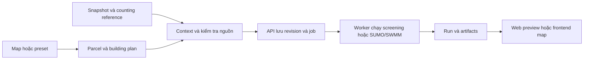

# UrbanDynamics — demo simulation tác động công trình

**Branch:** `feat/khoi-building-impact-simulation` · **Cập nhật:** 14/10/2026.

## Đọc phần này trước: simulation làm được gì?

Simulation trả lời: **Nếu xây công trình ở đây, các nhu cầu và điều kiện xung quanh thay đổi bao nhiêu? Phương án nào có đánh đổi đáng chú ý?**

Bạn chọn đất và nhập **building plan** — phương án công trình gồm công năng, quy mô, tầng/sàn, số người và các thiết kế liên quan. Hệ thống tính hiện trạng và phương án sau xây bằng cùng điều kiện, rồi so sánh hai kết quả. Khi xây thay công trình cũ, tải của công trình cũ được bỏ và tải mới được thêm; không cộng cả hai như thể cùng hoạt động.

### Chức năng đang có

| Chức năng | Bạn xem được gì? | Tính từ đâu? |
|---|---|---|
| Quy mô và bề mặt đất | Số căn, cư dân, diện tích sàn, đất xanh, bề mặt không thấm | Ranh đất, công trình/bề mặt nền và building plan |
| Điện | Điện năng ngày, đỉnh tải chung, có vượt capacity không | Sàn × hệ số điện theo công năng, phân bổ theo giờ, cộng tải nền |
| Nước cấp | Nhu cầu m³/ngày, còn dư hay vượt capacity | Số người × định mức, cộng tưới cây, trừ tái sử dụng nếu khai báo |
| Nước thải | Lượng nước thải và đối chiếu capacity | Nước dùng trong nhà × hệ số hồi lưu, trừ phần tái sử dụng |
| Chỗ học | Học sinh phát sinh, được/chưa được phân bổ, khoảng đi bộ | Cư dân × tỷ lệ tuổi học; đường tới trường và chỗ học còn trống |
| Giao thông | Chuyến phát sinh; native có delay, hàng chờ, xe hoàn thành/tồn đọng và lớp đường | Nhu cầu đi lại từ plan + luồng nền; SUMO mô phỏng từng xe |
| Thoát nước | Runoff — lượng nước chảy tràn; native có tràn nút, lưu lượng và diễn biến SWMM | Mưa, bề mặt thấm/không thấm, bể trữ và mạng cống khai báo |
| Bóng công trình | Diện tích bóng trong/ngoài khu đất, thay đổi theo giờ | Vị trí mặt trời, footprint, chiều cao và công trình/cây nền |
| Đối chiếu quy hoạch | Công năng đề xuất có xung đột với nhãn nguồn không | Nhãn quy hoạch parcel và công năng trong plan; không xác nhận quyền xây |

Ngoài chín nhóm trên, demo còn có:

- **So sánh vị trí:** cùng một chương trình xây dựng trên các ứng viên đất khác nhau.
- **Tác động cộng dồn:** xây nhiều công trình và so các tổ hợp.
- **Theo giai đoạn:** xem tác động tăng thêm khi xây tiếp từng giai đoạn.
- **Độ nhạy:** thay giả định đầu vào để xem kết luận có đổi; native chạy nhiều seed — các lượt có ngẫu nhiên khác nhau.
- **Lưu và mở lại:** giữ đầu vào, kết quả, nguồn; theo dõi/hủy/chạy tiếp job và tải artifact.
- **Counting:** pipeline riêng dùng YOLO/tracking để đếm xe video, tạo tham chiếu cho luồng nền. Không phải camera trực tiếp của toàn thành phố.
- **Gộp đất cho một building plan:** chọn các thửa chung cạnh, gộp thành một project và nhập tổng căn/cư dân/sàn một lần. Có kiểm tra ranh, nguồn từng thửa và baseline không đếm trùng.
- **Đối chiếu QCVN đô thị 2021:** tính chỉ tiêu nước sinh hoạt tối thiểu, chỗ/đất học theo từng cấp, bán kính dịch vụ và mật độ nhóm chung cư. Đây là yêu cầu bố trí tham chiếu, tách khỏi consumption forecast và capacity thực tế.

### Hai nâng cấp trước khi nộp — dùng như thế nào?

**Gộp parcel:** nạp snapshot, chọn hai hoặc nhiều thửa liền kề rồi bật **Gộp các parcel đang chọn thành một khu dự án**. Nhập 20 căn, 60 cư dân, 1.600 m² sàn nghĩa là tổng của **một project**, không nhân theo số thửa. Building phải nằm trong union; các thửa rời nhau, chỉ chạm góc hoặc chồng lấn bị từ chối. Gộp geometry không thay quyền sử dụng đất hoặc nhãn quy hoạch. Chưa tính GPMB khi thiếu giá áp dụng và đơn giá tài sản/phá dỡ.

**QCVN:** bật **Kèm đối chiếu QCVN đô thị 2021**, nạp lại và chạy một revision mới. Kết quả có panel **Chỉ tiêu tối thiểu theo QCVN — tách khỏi nhu cầu vận hành**:

| Đối chiếu | Cách tính / phạm vi |
|---|---|
| Nước sinh hoạt nội thị tối thiểu | Dân số đủ căn cứ × 80 L/người/ngày / 1.000, theo mục 2.10.2; không phải tổng mọi thành phần cấp nước hoặc mức tiêu thụ thực |
| Chỗ học tối thiểu | Mầm non/tiểu học/THCS: 50/65/55 chỗ trên 1.000 dân, làm tròn lên; đất theo 12/10/10 m²/chỗ, bảng 2.4 |
| Bán kính dịch vụ | 500 m trong profile này; không mặc định THCS 1.000 m. Khoảng thẳng tâm khu đất tới trường có cấp xác định khác với khoảng đi bộ trên mạng đường |
| Mật độ chung cư | Nội suy bảng 2.9 theo diện tích đất và chiều cao; hơn 46 m xét thêm FAR 13. Công trình hỗn hợp chiều cao/công năng hoặc đế-tháp cần đánh giá riêng |

Catalog có số phiên bản, hash, điều khoản, nguồn và phạm vi. Trường OSM không rõ cấp không được tự coi là tiểu học/THCS. Thiếu occupancy thì không biến requirement thành 0. Capacity giả lập vẫn ghi giả lập; kết quả trong ngưỡng tham chiếu không xác nhận được phép xây.

Mô hình **nhu cầu vận hành** bên dưới vẫn dùng hệ số theo công năng/profile của run (ví dụ nhà ở base 120 L/người/ngày). Không hạ số dự báo xuống 80 L rồi gọi đó là chính xác hơn: 80 là mức tối thiểu trong quy hoạch. Xem [contract API và hướng dẫn bàn giao frontend](docs/simulation-submission-handoff.md) và [catalog máy đọc](backend/app/services/simulation/planning/vietnam_catalog.json).

Kiểm thử nâng cấp 14/10: **209/209 test simulation/counting**, case gộp hai parcel thật chạy Screening và SUMO/SWMM OSM với ba seed, **3 nhóm UI đạt**. [Báo cáo và case mở lại local](docs/simulation-submission-test-report.md). Chứng cứ kiểm thử không đồng nghĩa dữ liệu giả lập đã được hiệu chỉnh thực địa.

### Dữ liệu nào thật, dữ liệu nào giả lập?

Khi nạp parcel, có hai lựa chọn:

| Chế độ | Ý nghĩa |
|---|---|
| **Nguồn thật** | Dùng dữ liệu đã cài có nguồn. Occupancy và capacity chưa có sẽ giữ **Chưa biết**, không tự điền số để kết luận |
| **Minh họa capacity v1** | Giữ geometry có nguồn, bổ sung hiện trạng vận hành và capacity **giả lập có nhãn** để thử mô hình và vượt ngưỡng |

"Nguồn thật" không có nghĩa mọi layer đều là đo đạc đầy đủ hoặc mới nhất. Parcel lấy từ hệ thống nhóm; footprint/đường/trường từ OSM; WorldCover 2021 là proxy bề mặt; WorldPop là ước tính dân số vùng. Không suy đất trống chỉ vì thiếu footprint.

Trong **gói giả lập v1**, các số sau được đặt trước, không phải mô hình tự tìm được:

| Đầu vào | Giá trị giả lập | Cách dùng |
|---|---|---|
| Cư dân công trình nền | Giả định nhà ở, `floor(sàn / 35)` người, `ceil(người / 3)` căn | Không phải khảo sát occupancy; giữ footprint/bề mặt đã nạp |
| Cư dân ngoài các parcel chọn | 1.200 người | Thay WorldPop cho nhu cầu trong case này; WorldPop vẫn giữ làm thông tin nền |
| Điện ngoài parcel / capacity | 80 kW mỗi giờ / 95 kW | Cộng tải parcel rồi so đỉnh chung với 95 kW |
| Nước ngoài parcel / capacity | 140 / 160 m³/ngày | Cộng nhu cầu parcel rồi so ngưỡng |
| Nước thải ngoài parcel / capacity | 112 / 128 m³/ngày | Cộng nhu cầu parcel rồi so ngưỡng |
| Trường và học sinh nền | 240 chỗ/trường; 216 học sinh ngoài parcel đặt tại trường đầu; không reserved chỗ ngoài vùng | Vị trí trường dùng OSM khi có, nếu thiếu thì thêm điểm giả lập trong vùng; chỗ học và phân bố học sinh đều giả lập |

Capacity là **khả năng phục vụ khai báo**, ví dụ hệ thống nước cung cấp tối đa 160 m³/ngày. Building làm thay đổi **nhu cầu**; capacity giữ nguyên nếu chưa có phương án nâng cấp hạ tầng. Các phương án dùng cùng nền/capacity để so sánh công bằng.

Traffic mặc định có thể lấy từ counts video UIT-ADrone đã cài và chuyển thành luồng nền giả định. Đây chưa phải lưu lượng thực tại từng con đường đang chọn. OD (xe đi từ đâu đến đâu), tín hiệu và mạng cống còn giả định; solver chạy thành công không chứng minh chúng đúng ngoài thực tế.

### Cách tính dễ hiểu — ví dụ chung cư 60 người, 1.600 m² sàn

Các hệ số dưới đây đúng với **case nhà ở base đã test**, không áp cho mọi công năng. Code lưu bộ hệ số thực tế trong từng run.

| Chỉ số | Cách tính trong case | Ví dụ |
|---|---|---|
| Nước sinh hoạt | Cư dân × 120 lít/người/ngày ÷ 1.000 | `60 × 120 / 1.000 = 7,2 m³/ngày` |
| Nước tưới | Đất xanh × 2 lít/m²/ngày ÷ 1.000 | 500 m² xanh cần 1 m³/ngày; 500 m² chỉ là ví dụ minh họa |
| Nước cấp | Nước trong nhà + tưới − tái sử dụng được giới hạn | Plan có thiết bị tiết kiệm/reuse thì nhu cầu được điều chỉnh |
| Nước thải | Nước trong nhà × 0,8 − tái sử dụng | Không reuse: `7,2 × 0,8 = 5,76 m³/ngày`; không tính nước tưới thành nước thải |
| Điện năng | Sàn × 0,11 kWh/m²/ngày | `1.600 × 0,11 = 176 kWh/ngày` |
| Đỉnh điện | Phân bổ điện năng theo giờ sử dụng, cộng tải cùng giờ, lấy giá trị lớn nhất | Building P1 tăng khoảng 16,88 kW tại đỉnh trong case đã chạy; không coi 176 kWh là 176 kW |
| Nhu cầu chỗ học | `ceil(cư dân × 18%)` theo project | `ceil(60 × 0,18) = 11 học sinh` |
| Chuyến người | Cư dân × hệ số trips/ngày, phân bổ giờ | Base nhà ở: `60 × 2 = 120 chuyến người/ngày`; chưa phải 120 xe |

Văn phòng, trường và bệnh viện có hệ số/đối tượng sử dụng khác; có thể tính thêm nhân viên, khách và người dùng. Điện có thể thêm sạc EV và xử lý nước tái sử dụng. Đỉnh toàn vùng là **đỉnh của tổng tải tại cùng giờ**, không cộng các peak ở các giờ khác nhau.

**Chỗ học:** hệ thống tìm đường đi bộ rồi phân bổ, ưu tiên phục vụ nhiều học sinh và giảm tổng khoảng đi bộ trong phạm vi chỗ còn trống và ngưỡng khoảng cách. Có chỗ trống nhưng trường quá xa vẫn có học sinh chưa được phân bổ. Trong P1, trường gần nhất cách khoảng 1.405 m, vượt ngưỡng 1.200 m nên 11 học sinh mới chưa được phân bổ.

**SUMO:** chuyến người được chuyển thành chuyến xe theo tỷ lệ phương tiện, số người/xe và giờ; kết hợp luồng nền, route, đèn/cổng để mô phỏng từng xe. Delay và queue là đầu ra mô phỏng, không phải số cư dân nhân một hệ số delay cố định. Luồng OD là lượng xe dự kiến xuất phát, không đồng nghĩa lượng xe trên mọi đường.

**Thoát nước:** Screening ước tính nước chảy tràn từ mưa × diện tích × hệ số bề mặt, xét lưu trữ. Native dùng SWMM để tính dòng chảy và trạng thái nút/cống theo thời gian. Chưa phải bản đồ độ sâu ngập 2D đã hiệu chỉnh.

**Bóng:** tính vị trí mặt trời theo ngày/giờ và bóng của hình khối công trình/cây. Đây là diện tích bóng, chưa phải dự báo nhiệt độ hay nhiệt độ cảm nhận.

**So sánh:** chạy hiện trạng và phương án với cùng điều kiện. `Chênh lệch = sau xây − trước xây`. Với xây thay thế: `tải sau = nền ngoài khu đất + tải công trình mới + tải các khu đất khác giữ nguyên`.

### Một case đã chạy ra kết quả gì?

Case ba parcel 1959486, 1958467, 1958799: mỗi building đề xuất 20 căn, 60 cư dân, 4 tầng và 1.600 m² sàn. Dùng **nền/capacity giả lập v1**. Các số là tổng vùng và các parcel đã đăng ký:

| Chỉ số | Hiện trạng mô phỏng | Chỉ xây P1 | Xây cả ba |
|---|---:|---:|---:|
| Cư dân | 1.210 | 1.270 | 1.380 |
| Đỉnh điện chung (kW) | 84,25 | 101,12 | 130,63 |
| Nước cấp (m³/ngày) | 144,23 | 150,07 | 166,67 |
| Nước thải (m³/ngày) | 112,96 | 118,72 | 129,28 |
| Học sinh cần chỗ | 218 | 229 | 249 |
| Học sinh chưa được phân bổ | 0 | 11 | 11 |

Chỉ xây P1 vượt capacity điện 95 kW; xây cả ba vượt cả điện, nước và nước thải. Tổng sau xây không bằng "hiện trạng + 180 người" vì phương án thay cả occupancy nền giả lập của các parcel. Chênh lệch nước cấp cũng xét thay đổi diện tích xanh/nước tưới. Kết luận vượt ngưỡng áp dụng **trong case giả lập**, không phải chứng cứ mạng hạ tầng thật quá tải.

### Chạy và xem như thế nào?

1. Mở **`/simulation/planning`** (local mặc định `http://127.0.0.1:8007/simulation/planning`).
2. Chọn preset hoặc nạp snapshot, chọn parcel và nhập plan. Form parcel hiện tạo chung cư sơ bộ; schema/JSON hỗ trợ thêm công năng khác.
3. Chọn **Nguồn thật** hoặc **Minh họa capacity v1**, rồi bấm **Nạp plan và dữ liệu nền**.
4. Bấm **Kiểm tra đầu vào**, xem dữ liệu thiếu và khối lượng chạy dự kiến.
5. Chọn cách chạy, bấm **Chạy và lưu**, chờ job hoàn thành.
6. Trong kết quả, chọn trạng thái **hiện trạng** hoặc phương án. Xem bảng **So với hiện trạng**, các kiểm tra capacity bên biểu đồ điện, lớp tác động, bảng **Thông số SUMO** và nguồn trong audit.

| Cách chạy | Có gì? | Khi nào dùng? |
|---|---|---|
| Screening | Nhu cầu, capacity, chỗ học, bóng, runoff sơ bộ; không có delay/queue SUMO hoặc kết quả solver SWMM | Xem tác động nhanh trước |
| SUMO + SWMM | Các phân tích trên và kết quả native theo giờ/seed | Xem giao thông và thoát nước sâu hơn |
| Độ nhạy | Reference và các ca thay giả định; có thể dùng engine Screening hoặc native | Xem kết luận có đổi khi dữ liệu/hệ số chưa chắc chắn |

Bộ độ nhạy mới thử nhu cầu low/high, capacity hạ tầng và trường −20%, mưa +20%, OD ×0,5/×1,25. Có OD thì gồm reference + sáu ca; không có OD thì bỏ hai ca traffic. Native dùng seed 2026–2028; Screening không sinh delay/queue khi thay OD. Đây là thử từng nhóm giả định, không phải khoảng tin cậy thống kê hoặc mọi tổ hợp bất lợi.

Nếu kết quả ghi **Chưa biết**, đó là chưa đủ đầu vào để kết luận; không phải bằng 0. Nếu ghi **scenario_only**, đó là kết quả trong giả định của kịch bản, không phải đo đạc hiện trạng thật. Nhiều phương án có thể đánh đổi; hệ thống không mặc định có một phương án thắng mọi tiêu chí.

### Đang có và chưa có trên web chính

- **Đã có:** demo độc lập, model, lưu job/run, so ứng viên, cộng dồn, giai đoạn, độ nhạy và kết quả có nguồn/layers.
- **Chưa nối vào React map của main:** cần frontend gọi API và adapter lấy đất/dữ liệu nền đúng khu được chọn. Không cần xây lại phần model đã làm. [Đánh giá nối main](docs/simulation-main-integration-review.md).
- **Đã có một building trên nhiều parcel chung cạnh:** bật gộp để tạo một project. Khi không bật gộp, chọn nhiều parcel vẫn tạo project riêng và quy mô nhập áp dụng cho từng project. Chưa có chuẩn bị live mọi parcel/zoning revision từ main; demo dùng snapshot đã cài.
- **Chưa có:** occupancy/capacity khảo sát đầy đủ, OD và tín hiệu hiệu chỉnh, mạng cống thực, flood depth 2D/thermal model và AI giải thích (đang hoãn).

Kiểm thử lần bổ sung nền/capacity: **27/27 backend**, hai job độ nhạy Screening/native và **4 nhóm UI** đạt. Đó là kiểm chứng tính toán và luồng demo, không chứng minh đầu vào giả lập đúng thực địa. [Báo cáo test](docs/simulation-capacity-test-report.md), [chi tiết hệ số nền/độ nhạy](docs/simulation-capacity-sensitivity.md).

Checkout mới chạy được preset synthetic. Parcel/snapshot thật, counts, dữ liệu job và video cần cài riêng; Git không chứa các artifact đó. `/simulation/integrated` là demo cũ có contract riêng; hướng dẫn chính của branch này dùng `/simulation/planning`.

## Tham khảo kỹ thuật

<details>
<summary>Mở chi tiết nguồn, cài đặt, API, code và bằng chứng cũ</summary>

Các mô tả occupancy/capacity "chưa biết" trong bảng và case cũ bên dưới áp dụng cho chế độ nguồn thật hoặc job cũ. Gói giả lập v1 được mô tả ở phần dễ hiểu phía trên.

### Mục lục

1. [Các tính năng và nguồn dữ liệu](#1-các-tính-năng-và-nguồn-dữ-liệu)
2. [Chạy demo từ checkout mới](#2-chạy-demo-từ-checkout-mới)
3. [Hướng dẫn dùng web](#3-hướng-dẫn-dùng-web)
4. [Đọc kết quả](#4-đọc-kết-quả)
5. [Counting và lưu lượng mặc định](#5-counting-và-lưu-lượng-mặc-định)
6. [Case đã chạy và độ tin cậy hiện trạng](#6-case-đã-chạy-và-độ-tin-cậy-hiện-trạng)
7. [Công thức và phương pháp](#7-công-thức-và-phương-pháp)
8. [Kiến trúc, lưu trữ và API](#8-kiến-trúc-lưu-trữ-và-api)
9. [Kiểm thử, giới hạn và tài liệu](#9-kiểm-thử-giới-hạn-và-tài-liệu)

## 1. Các tính năng và nguồn dữ liệu

README đếm **9 nhóm phân tích**, không đếm mỗi chỉ số thành một feature. Một nhóm có đường tính không có nghĩa mọi đầu vào đã đủ hoặc đã được hiệu chỉnh.

| # | Nhóm | Dữ liệu dùng | Lấy dữ liệu ở đâu / tạo giả lập như thế nào? | Kết quả | Trạng thái case parcel thật |
|---|---|---|---|---|---|
| 1 | Quy mô xây dựng và bề mặt đất | Ranh parcel hệ thống; footprint OSM; WorldCover; building plan | **Nguồn:** snapshot API parcel của nhóm, footprint OSM, raster ESA WorldCover 2021 cắt theo đất. **Giả định:** thiếu tag tầng/cao thì dùng 1 tầng/3 m; phần bề mặt chưa phân loại chia 50% lát, 10% thấm, 40% xanh. Preset synthetic tạo polygon và plan từ fixture; không biến thiếu footprint thành đất trống. [Cách chuẩn bị nền](backend/app/services/simulation/integrated/background.py). | Căn hộ, diện tích sàn, xanh và không thấm | Ranh có nguồn; hiện trạng công trình/bề mặt còn ước tính |
| 2 | Giao thông | OSM hoặc mạng synthetic; counting prior; trips từ công trình; OD, cổng, đèn và seed | **Nguồn:** đường OSM trong snapshot; counts từ video UIT-ADrone qua YOLO/tracking. **Giả lập:** ngoại suy counts thành rate, chuyển làm proxy nền; trips công trình từ số người × hệ số, mode share/occupancy và profile giờ. Chia OD đều trên các route ngoại vi có thể đi; nối cổng vào junction gần phù hợp; netconvert tạo timing đèn. Chế độ synthetic tạo corridor/access bằng thuật toán. [OSM network](backend/app/services/simulation/planning/osm_network.py), [counting](scripts/traffic-counting/README.md). | SUMO: xe hoàn thành/tồn đọng, delay, queue, tốc độ đoạn đường | Đã chạy native; chưa hiệu chỉnh luồng xe/OD tại khu đất |
| 3 | Thoát nước/runoff | Mưa, bề mặt, lưu trữ và graph cống/cửa xả | **Nguồn:** bề mặt từ baseline/plan; storage từ thiết kế. **Giả lập:** conditions khai báo mưa, ví dụ 60 mm/60 phút; graph SWMM tạo nhánh nối từng parcel vào cống chung và cửa xả tự do. Đường kính, cao độ, đất và vùng nền lấy từ tham số catchment/fixture, không lấy từ khảo sát cống; chưa có triều/DEM hiệu chỉnh. [Graph/solver](backend/app/services/simulation/planning/drainage.py). | Runoff screening; SWMM node/link/time series, tràn nút và flow/depth | Solver native đã có; mưa và hạ tầng là kịch bản |
| 4 | Điện | Công năng, sàn, EUI, lịch giờ, EV và reuse | **Nguồn:** sàn/công năng từ plan hoặc inventory; catalog `reviewed` dùng benchmark điện văn phòng 116,4 kWh/m²/năm. **Giả định:** công năng khác dùng hệ số demo, ví dụ chung cư 0,11 kWh/m²/ngày; phân bổ theo profile 24 giờ, thêm EV/reuse theo thiết kế. Tải nền/capacity synthetic do fixture khai báo cho vùng dùng chung; case thật thiếu thì giữ unknown. [Hệ số và nguồn](docs/simulation-demand-coefficients.md). | kWh/ngày, kW theo giờ, đỉnh tải và capacity check | Tính nhu cầu plan; tải/công suất nền chưa xác minh |
| 5 | Nước cấp | Người theo vai trò, định mức công năng, tưới, thiết bị và reuse | **Nguồn:** cư dân/nhân viên/khách từ plan; diện tích xanh từ geometry; catalog có tài liệu tham chiếu nhưng chưa có số tiêu thụ đã đo tại parcel. **Giả định:** định mức theo công năng, ví dụ nhà ở 120 L/người/ngày, tưới 2 L/m²/ngày; áp tiết kiệm thiết bị và trừ reuse. Nền/capacity do fixture khai báo trong synthetic, không tự suy ra từ WorldPop; case thật giữ unknown khi thiếu. [Công thức/nguồn](docs/simulation-demand-coefficients.md). | m³/ngày và capacity check khi có | Theo hệ số; nền/năng lực cấp nước còn thiếu |
| 6 | Nước thải | Nước trong nhà, hồi lưu và reuse | **Nguồn:** lượng nước trong nhà đã tính và reuse của plan; chưa có đo xả/công suất xử lý tại khu demo. **Giả định:** nước thải = nước trong nhà × tỷ lệ hồi lưu, mặc định 0,8, trừ reuse được giới hạn; không tính toàn bộ tưới vào nước thải. Capacity synthetic khai báo trong fixture, case thật thiếu thì unknown; không có mạng ống vệ sinh khảo sát. [Công thức/nguồn](docs/simulation-demand-coefficients.md). | m³/ngày và kiểm tra năng lực khi có | Theo hệ số; năng lực thu gom/xử lý còn thiếu |
| 7 | Trường học | Cư dân, tỷ lệ tuổi học, vị trí trường, graph đi bộ, sức chứa | **Nguồn:** điểm trường và graph foot OSM trong snapshot; cư dân từ plan. **Giả định:** nhu cầu = ceil(cư dân × tỷ lệ tuổi học), mặc định 0,18; nối hai đầu tuyến vào graph bằng connector ước tính, tối đa 300 m mỗi đầu. Preset synthetic khai báo vị trí/capacity/reserved places và nhóm học sinh nền; trường từ OSM thiếu capacity thì không tự gán số chỗ. [Phân bổ](backend/app/services/simulation/planning/services.py). | Nhu cầu, khoảng đi bộ, phân bổ chỗ khi đủ dữ liệu | Có tuyến/điểm OSM; capacity/enrollment/nền học sinh chưa biết |
| 8 | Bóng đổ | Footprint, chiều cao, cây được map, mặt trời và receiver chung | **Nguồn:** footprint/height/levels/cây có tag từ OSM hoặc inventory frontend; công trình đề xuất từ plan. **Giả định:** thuộc tính thiếu dùng default có nhãn; receiver phẳng cố định, vật thể được coi là chắn sáng. Tính mặt trời theo ngày/giờ và chiếu geometry; giữ cùng bối cảnh giữa options. Case địa phương có 23 footprint lân cận nhưng đều thiếu chiều cao, 0 cây được map; không có nghĩa ngoài thực tế không có cây. [Bối cảnh và giới hạn](docs/planning-remaining-groups-implementation.md). | Bóng tại 9/12/15h và bóng ngoài đất | Geometry đã có; nhiều chiều cao mặc định; chưa phải nhiệt độ |
| 9 | Đối chiếu công năng quy hoạch | Mã đất, nhãn quy hoạch, đồ án/quyết định và plan | **Nguồn:** thuộc tính parcel trong snapshot API nhóm, như `mdsdd`, `loai_dat_qh`, `do_an`, `quyet_dinh`. **Cách đánh giá:** đối chiếu nhãn với công năng, tính mật độ/FAR đề xuất từ plan; thiếu ngưỡng được phép thì giữ chưa xác minh. Không tự tạo quy định hoặc legal pass; fixture synthetic chỉ minh họa kịch bản, không thay hồ sơ pháp lý. [Kiểm tra quy hoạch](backend/app/services/simulation/planning/planning_review.py). | Cảnh báo xung đột, mật độ/FAR đề xuất | Chưa xác nhận đầy đủ chỉ tiêu/pháp lý |

**Phân biệt hai trường hợp thiếu dữ liệu:** preset synthetic có thể khai báo một nền/capacity giả lập để thử mô hình; case parcel thật không tự điền mọi giá trị thiếu bằng số giả. Cột trên mô tả phương pháp hiện có, không xác nhận những giả định đó đã được đo hoặc hiệu chỉnh tại địa phương.

Các chức năng dùng chung:

- **5 mẫu bài toán:** so vị trí A/B/C; một đất trên nền chung; xây cộng dồn; di dời; snapshot tổng vùng đã chứa tải của đất.
- **3 chế độ chạy:** Screening, SUMO + SWMM, Độ nhạy + 3 seed.
- **6 lớp sơ đồ:** parcel, trường học, bóng đổ, đường SUMO, nút SWMM, cống SWMM.
- Schema hỗ trợ tối đa **6 project**, **12 phương án**, **4 giai đoạn**; UI chọn tối đa 6 parcel.
- Giữ cùng chương trình khi so vị trí; plan riêng mỗi đất; nhóm xây đồng thời; ledger thay thế/di dời để tránh cộng trùng.
- Chuẩn hóa tác động theo sàn/căn/cư dân hoặc mẫu số phục vụ; Pareto/trọng số khi có tiêu chí và đủ chỉ số.
- Job chạy nền, tiến độ, hủy/retry, mở lại, nguồn bất biến và xuất JSON/CSV/GeoJSON/ZIP.

**Chưa hoàn thành trong planning:** mô hình tác động giá đất/chi phí, nhiệt độ/UTCI, ngập mặt đất 2D, phân bổ sức chứa bệnh viện/công viên. Lớp dữ liệu có trên map không tự có nghĩa đã đi vào simulation.

### Nguồn dữ liệu cụ thể

| Nguồn | Dùng làm gì? | Giới hạn |
|---|---|---|
| Backend nhóm/server 156 | Snapshot ranh parcel và thuộc tính quy hoạch | Nguồn hệ thống, chưa phải xác nhận pháp lý hoặc khảo sát đầy đủ |
| WorldPop | Ước tính dân số vùng trong bbox | Không phải số cư dân từng parcel; có thể đã bao gồm cư dân tại đất chọn |
| OpenStreetMap | Đường, footprint, điểm trường và tuyến đi bộ | Tag/inventory có thể thiếu; không tự có counts/OD/đèn/capacity thực |
| ESA WorldCover 2021 v200, 10 m | Phân loại bề mặt xanh/built-up, cắt theo parcel | Lịch sử 2021; built-up không đo độ thấm, xanh không đồng nghĩa công viên |
| UIT-ADrone + detector/tracking | Tham chiếu loại xe và rate chuyển làm giả định | Clip ngắn, chưa phải lưu lượng hiện tại tại parcel hay cả thành phố |
| Library/catalog hệ số | Nhu cầu điện, nước, nước thải, trips | Nhiều hệ số và profile là giả định, cần hiệu chỉnh |
| Fixture/kịch bản | Mưa, graph cống/cửa xả, capacity synthetic và vận hành | Không phải quan trắc hạ tầng |

Catalog được tài liệu hóa có **57 hệ số**: 1 hệ số điện văn phòng dùng benchmark nghiên cứu địa phương; 56 hệ số chưa có nguồn số trực tiếp phù hợp được xác minh. Giá trị thực phải đọc từ context của run; URL tham chiếu không chứng minh mọi giá trị là quan trắc. [Chi tiết hệ số](docs/simulation-demand-coefficients.md).

**Snapshot** là bản dữ liệu đã chụp và lưu, không phải live data. Ngày lấy snapshot không phải ngày quan trắc của từng nguồn. Case `synthetic` dùng fixture; case `demo_system` dùng snapshot có nguồn kết hợp giả định/unknown. Thiếu dữ liệu không tự đổi thành 0.

## 2. Chạy demo từ checkout mới

### Khởi động bằng Docker

Máy cần Git và Docker Engine hoạt động. SUMO/SWMM chạy CPU; pipeline counting riêng có thể dùng GPU.

```powershell
git clone --branch feat/khoi-building-impact-simulation https://github.com/RodrickSia/UrbanDynamics.git
cd UrbanDynamics
New-Item -ItemType Directory -Force .runtime/planning-system/snapshots
docker compose -f compose.simulation-demo.yaml up --build -d
```

Mở **http://127.0.0.1:8007/simulation/planning**; API docs ở **http://127.0.0.1:8007/docs**.

Nếu 8007 đang được instance khác dùng, đặt `$env:SIMULATION_DEMO_PORT = '8012'` trước lệnh compose rồi mở cổng 8012. Compose này dựng API/worker simulation với SQLite, không dựng toàn bộ map/ETL/PostGIS của nhóm.

Checkout mới thử được **Bài toán → Nạp mẫu → Kiểm tra đầu vào → Chạy và lưu** bằng preset synthetic. Git không chứa snapshot địa phương, database job/run, solver output, video, weights, `.env` hoặc credentials. Vì vậy chưa cài snapshot thì chưa có parcel thật; chưa cài reference thì chưa có default clip22; Job UUID trong báo cáo không tự xuất hiện sau clone.

### Cài dữ liệu riêng

Snapshot theo SHA-256 đặt ở `.runtime/planning-system/snapshots`, mount readonly vào `/system-snapshots`. API/worker phải dùng cùng nguồn; không sửa file mà giữ hash cũ.

`scripts/prepare-simulation-background.py` nhận `--base-url`, `--site-file`, `--radius-m`, `--output-dir` và tùy chọn SSH/container. Cần quyền truy cập API của nhóm và đúng vùng nghiên cứu. Xem [snapshot](docs/planning-system-demo-connection.md) và [tiến độ mới](docs/planning-remaining-groups-implementation.md); các báo cáo lịch sử có ghi model/mốc riêng.

Sau khi pipeline counting tạo folder review có `review-summary.json` và `config.json`:

```powershell
python scripts/traffic-counting/install_flow_default.py --review <folder-review> --destination .runtime/planning-system/snapshots/counting
```

Installer tạo reference theo hash và pointer `default-reference.txt`; có thể chọn bằng `PLANNING_DEFAULT_COUNTING_REFERENCE_ID`. Video/model chuẩn bị riêng theo [counting README](scripts/traffic-counting/README.md), không tự tải khi bấm chạy simulation.

## 3. Hướng dẫn dùng web

### Chọn mẫu hoặc chuẩn bị parcel thật

| Mẫu | Mục đích |
|---|---|
| So A/B/C | Cùng chương trình, thử tại các vị trí khác nhau |
| Một đất trên nền chung | Tác động một công trình trong bối cảnh vùng |
| Cộng dồn | Xây riêng/xây cùng và giai đoạn |
| Di dời | Theo dõi người chuyển vị trí, tránh tính thành người mới hai lần |
| Snapshot đã chứa A | Trừ tải hiện hữu đã nằm trong tổng vùng trước khi thêm phương án |

**Nạp mẫu** chỉ đổi JSON, chưa chạy mô hình. Với job mở lại, JSON được phục hồi là đầu vào của job; tên dropdown mẫu không thay thế đầu vào đã lưu.

Luồng parcel thật:

1. Chọn snapshot → **Nạp parcel thật** → chọn tối đa 6 polygon/parcel.
2. Nhập căn, cư dân, tầng và tổng sàn. Giữ **Cùng chương trình khi so vị trí** để so quy mô tương đương; có thể khai báo chương trình riêng.
3. Chọn xây một trong các vị trí hoặc cộng dồn; thêm nhóm đồng thời như P1+P3 nếu cần.
4. Chọn mạng OSM và reference counting. Để trống đỉnh OD để dùng default đã cài; nhập số để override.
5. **Dùng parcel và nền này** tạo JSON, chưa chạy solver. Xem/chỉnh plan trước khi tính.

Builder là giao diện đơn giản. Plan đầy đủ gồm footprint/chiều cao, xanh/lát/thấm, storage, reuse, EV và vận hành theo schema JSON; frontend có thể gửi qua `developments`. Adapter/library chuẩn bị dữ liệu nền và hệ số; phần thiếu vẫn phải ghi rõ.

### Chọn cách chạy

| Web / API mode | Chức năng |
|---|---|
| Screening / `screening` | Tính sơ bộ quy mô/nhu cầu/runoff/trường/bóng; chưa chạy SUMO/SWMM |
| SUMO + SWMM / `native` | Solver giao thông và thoát nước, có đường/nút/cống theo thời gian |
| Độ nhạy + 3 seed / `uncertainty` | Thử giả định và seed; cần nhiều lượt solver hơn |

**Seed** điều khiển ngẫu nhiên; cùng seed/giờ giữ điều kiện tương ứng, nhiều seed kiểm tra độ ổn định. **Kiểm tra đầu vào** kiểm tra schema/geometry/IDs/chương trình/giai đoạn/công việc, không xác nhận pháp lý hoặc độ đúng thực địa.

**Chạy và lưu** tạo job; chờ status **Hoàn thành và lưu run**. Có thể mất nhiều phút. Poll timeout không nghĩa worker dừng; dùng **Mở lại** với Job UUID để kiểm tra thay vì tạo lượt trùng. **Hủy job** yêu cầu dừng; **Chạy tiếp job cũ** dùng input cũ và child hợp lệ đã xong. Sửa plan cần revision/run mới; đổi JSON ẩn kết quả cũ.

## 4. Đọc kết quả

### Điều khiển và 6 lớp sơ đồ

**Trạng thái / phương án** là dropdown chọn Hiện trạng, option hoặc phase. **Giả định đầu vào** chọn case độ nhạy. Khung nhìn, giờ bóng, giờ/seed/khoảng SUMO và thời điểm SWMM chọn dữ liệu đã tính, không tự chạy lại hoặc fetch nền mới. Nút **Đi đến bảng SUMO** ở đầu trang giúp tìm bảng sau khi tải kết quả.

| Lớp | Đọc thế nào? |
|---|---|
| Khu đất | Ranh và project đang active |
| Trường học | Điểm/tuyến đi bộ; access-only chưa xác nhận có chỗ học |
| Bóng đổ | Bóng tại 9/12/15h, chưa phải nhiệt độ |
| Đường SUMO | Đỏ khi speed <5 m/s, khoảng 18 km/h; màu xanh không xác nhận hết ùn tắc |
| Nút SWMM | Mực nước/tràn nút trong mạng mô hình |
| Cống SWMM | Flow/depth của link theo mẫu |

Rê chuột lên đối tượng để xem tooltip. `entered/left` là số xe vào/ra đoạn trong khoảng chọn, không phải xe/giờ mặc định. Queue lấy mẫu theo lane, không cộng chiều dài lane; thiếu record không thay bằng 0. Sơ đồ preview chưa có nền vệ tinh. Tràn nút SWMM chưa phải độ sâu ngập mặt đất.

### Bảng thông số SUMO tuyệt đối

**Thông số SUMO của lượt chạy** nằm ngay trước **So với hiện trạng**, gồm hai cột baseline mô phỏng/phương án. Đây là số của solver với assumptions đã lưu, kể cả khi chưa đủ dữ liệu công bố chênh lệch.

| Chỉ số | Ý nghĩa |
|---|---|
| Xe nền, ô tô, xe máy | Profile nền ở giờ chọn, xe/giờ |
| Xe dự kiến | Nền + công trình được lên lịch trong giờ |
| Xe đã vào mạng | Đã chèn vào SUMO |
| Xe hoàn thành | Đi xong trước lúc kết thúc |
| Xe chưa hoàn thành | Đã vào nhưng chưa đi xong |
| Xe chưa vào mạng | Đã lên lịch nhưng chưa chèn được |
| Tồn đọng | Chưa hoàn thành + chưa vào |
| Tỷ lệ hoàn thành | Hoàn thành / dự kiến ×100% |
| Delay xe hoàn thành | Time loss trung bình riêng xe đã kết thúc |
| Delay xe nền hoàn thành | Time loss của nhóm nền đã kết thúc |
| Queue tối đa | Chiều dài hàng chờ lớn nhất, m |
| Bảo toàn xe | Dự kiến = hoàn thành + chưa hoàn thành + chưa vào |

Xe xuất phát trong 3.600 giây; SUMO chạy tới giây 4.200. **Delay thấp nhưng backlog cao không chứng minh tốt hơn**. Screening chưa có lượt SUMO, bảng báo chưa chạy.

### So với hiện trạng và các bảng khác

`scenario_only` nghĩa là trong phạm vi kịch bản, chưa xác minh thực địa. `insufficient_data` nghĩa là chưa đủ để so sánh, hiển thị **Chưa biết**, không phải 0. Case parcel thật thiếu occupancy nên cư dân/điện/nước/trips/trường và traffic comparison có thể bị chặn, trong khi raw SUMO vẫn có số. Không giả định nhà hiện hữu không có người để tạo delta.

Chọn một option để xem before/after; chọn Hiện trạng không có phương án đối chiếu trong bảng delta. Bảng SUMO vẫn xem baseline được.

| Phần khác | Chức năng |
|---|---|
| Điện theo giờ/capacity | Tổng tải tại cùng giờ và năng lực nếu có; thiếu capacity ghi unknown |
| Quy hoạch | Cảnh báo theo nhãn, mật độ/FAR đề xuất, không phê duyệt |
| Chuẩn hóa | Tác động trên m² sàn/căn/cư dân hoặc mẫu số đã khai báo |
| Đánh đổi/giai đoạn | Pareto khi đủ tiêu chí, tác động so phase trước; không tự chọn winner |
| Hiện trạng/thay thế/di dời | Ledger tải cũ được giữ/trừ/thay và chuyển cư dân |
| Nguồn/phạm vi | Manifest, coverage và phần thiếu của từng module |
| Độ nhạy/ổn định | Khoảng giữa seed/case, không phải khoảng tin cậy thống kê |
| Audit/ZIP | Hash, validity, giới hạn; tải input/result/CSV/GeoJSON/solver artifacts |

## 5. Counting và lưu lượng mặc định

Video → detector pretrained → tracking ID → đếm qua vạch → recount ID trùng → summary/CSV/video bounding box → reference theo hash → traffic prior. Model thử nghiệm: **VisDrone YOLOv8m + BoT-SORT**. Recount overlap chưa sửa mọi fragmentation/bỏ sót/chuyển động camera; chưa công bố độ chính xác độc lập.

Đã visualize **3/3 clip tải trên server 152**, mỗi clip 500 frame: clip16 **17**, clip22 **19**, clip31 **13** lượt. Đây chưa phải toàn bộ test set UIT-ADrone.

Clip22 `50m_90d_morning_congkhuA_22_3_0`: **500 frame /30 fps =16,67 giây**, vạch kéo dài tới y=0.65.

| Loại | Số lượt | Ngoại suy xe/giờ |
|---|---:|---:|
| Xe máy | 17 | 3.672 |
| Ô tô | 1 | 216 |
| Bus | 1 | 216 |
| Tổng hai hướng | 19 | **4.104** |

`q = count ×3600 / thời lượng thực`. SUMO hai lớp ô tô/xe máy dùng **3.888 xe/giờ**; bus giữ trong reference, chưa đưa vào solver hai lớp. Profile 24 giờ cố định là giả định, không suy được ngày/cao điểm từ clip ngắn.

Để trống đỉnh OD dùng default đã cài; nhập mức riêng dùng amplitude/profile giả định riêng, 0 được giữ đúng. Run cũ giữ reference đã freeze.

Default có thể chuyển cho đường thiếu dữ liệu, ưu tiên số liệu riêng khi caller cung cấp. **SUMO hiện dùng một proxy OD tổng vùng, không bơm 3.888 xe vào từng internal edge** vì một xe đi qua nhiều edge. Chưa gán rate vào mọi đường thành phố hoặc bảo đảm mỗi đường có đúng lưu lượng đó. [Chi tiết](docs/traffic-city-demo-default.md).

## 6. Case đã chạy và độ tin cậy hiện trạng

Case chung cư what-if tại Thủ Đức trên parcel **1959486 /1958467 /1958799**. Mỗi project: **20 căn, 60 cư dân, 4 tầng, 1.600 m² sàn**. Có 5 options/3 phases; OSM network; giờ18; seed2026; counting clip22.

| Phương án | Dự kiến | Hoàn thành | Tồn đọng | Delay xe hoàn thành (s) | Queue (m) |
|---|---:|---:|---:|---:|---:|
| Baseline mô phỏng | 3.888 | 3.019 | 869 | 39,00 | 300,09 |
| P1 | 3.895 | 2.782 | 1.113 | 37,92 | 357,11 |
| P2 | 3.895 | 3.710 | 185 | 42,48 | 99,02 |
| P3 | 3.895 | 3.459 | 436 | 40,45 | 463,14 |
| P1+P2 | 3.902 | 3.902 | 0 | 42,66 | 38,11 |
| Cả3 | 3.909 | 3.909 | 0 | 43,44 | 41,61 |

Đây là số mô hình, không đo tại parcel. Khác biệt lớn giữa xây riêng/xây cùng cần nhiều seed và sensitivity. Case còn cảnh báo công năng quy hoạch, chưa phải phương án được phép xây.

Job `7ae2d330-34b8-4389-94fc-7b77ab8219ca`, run `dc054c7a-5199-4d56-bae2-2fb0ea2595c4`.

[Mở bảng SUMO trên instance của tác giả](http://127.0.0.1:8007/simulation/planning?job=7ae2d330-34b8-4389-94fc-7b77ab8219ca&option=together_3&view=sumo&ui=20261013b).

**Link chỉ có kết quả trên instance giữ database/volume của phiên đó; clone không sao chép job.** Case đạt count balance SUMO và mass balance SWMM. Một child timeout ở120 rồi300 giây, được retry với600 giây. Thời gian chạy/payload vẫn cần tối ưu.

### Các số baseline lấy ở đâu, có chính xác không?

| Số trong case | Nguồn và giả định |
|---|---|
| Căn hộ0 | Chưa có số căn hiện hữu; không chứng minh không có nhà ở |
| Sàn402,45 m² | Hai footprint OSM cắt theo parcel; thiếu tag tầng/cao nên giả định1 tầng,3 m |
| Xanh1.513,54 m² | WorldCover2021, proxy nhóm bề mặt xanh/cây trồng, chưa khảo sát công viên |
| Không thấm3.068,44 m² | Mái OSM và built-up proxy coi như không thấm; chưa đo độ thấm |
| Runoff175,86 m³ | Screening theo mưa giả định60 mm/60 phút và hệ số bề mặt |
| Bóng1.861,78 m²; ngoài đất1.818,30 m² | Tính hình học/mặt trời, nhiều chiều cao mặc định; không phải nhiệt |
| Tràn nút4,64 m³; đỉnh runoff≈0,38 m³/s | SWMM trên mạng/cửa xả/mưa giả định; không đo ngập thực tế |
| SUMO baseline | 3.888 xe nền giả định; OD/đèn/cổng và hành vi chưa hiệu chỉnh |

Baseline nghĩa là **hiện trạng mô hình hóa từ nguồn và giả định**, không mặc nhiên là số liệu chính xác ngoài thực tế. Occupancy/capacity thiếu thì kết luận so sánh giữ unknown. Footprint OSM bằng0 không chứng minh đất trống.

## 7. Công thức và phương pháp

Phải dùng hệ số/context của run, không áp mọi default cho mọi công năng.

| Nhóm | Cách tính chính |
|---|---|
| Sàn/bề mặt | Diện tích polygon; sàn khai báo hoặc footprint×tầng; tổng bề mặt theo plan |
| Nước trong nhà | Tổng người theo vai trò×định mức công năng /1.000 để đổi L thành m³, áp hệ số thiết bị |
| Nước cấp | Nước trong nhà+tưới−reuse được giới hạn theo lượng có thể tái sử dụng |
| Nước thải | Nước trong nhà×hồi lưu−reuse; không coi toàn bộ nước tưới là nước thải |
| Điện | Sàn×EUI theo công năng+EV+xử lý reuse, phân bổ profile giờ |
| Trips | Người theo vai trò×trips/ngày, chia theo mode share/occupancy xe, phân bổ giờ |
| SUMO | Mô phỏng từng xe, route, tương tác, đèn và cổng; không tuyến tính từ căn hộ sang delay |
| Runoff | Mưa×diện tích theo hệ số bề mặt, xét storage |
| SWMM | Runoff/mạng thoát nước theo thời gian; node/link series và mass balance |
| Trường | `ceil(cư dân×tỷ lệ tuổi học)` theo parcel; đường ngắn nhất; phân bổ chỗ dùng chung khi đủ capacity |
| Bóng | Mặt trời+footprint/chiều cao; hợp bóng trên receiver cố định giữa phương án |
| Mật độ/FAR | Footprint xây dựng/diện tích đất; tổng sàn/diện tích đất; chưa xác định ngưỡng pháp lý |

Ví dụ giả định base: nước chung cư120 L/người/ngày, điện chung cư0,11 kWh/m²/ngày, hồi lưu0,8, trips người thường2/ngày. Điện văn phòng profile `reviewed` có benchmark116,4 kWh/m²/năm chuyển sang ngày; không áp benchmark văn phòng sang nhà ở. [Catalog đầy đủ](docs/simulation-demand-coefficients.md).

Capacity check cần nền/năng lực khai báo. Đỉnh điện là **đỉnh tổng tại cùng giờ**, không cộng các peak khác giờ. Pareto là tập phương án đánh đổi theo tiêu chí, không tự có winner; thiếu metric yêu cầu thì không xếp hạng bằng số thay thế.

## 8. Kiến trúc, lưu trữ và API



**API FastAPI** nhận/lưu plan và trả job/layers. **Worker** là tiến trình riêng, chạy solver, checkpoint/cancel/retry/cache child. **Snapshot/reference** freeze theo hash. **Counting** là pipeline AI dữ liệu riêng; SUMO/SWMM là solver mô phỏng, không tự là AI. Phần AI giải thích kết quả đang hoãn.

### Lưu trữ

| Loại | Nơi lưu |
|---|---|
| Study/revision/job/run/cache metadata | SQLite `/runtime/studies.sqlite` trong volume compose demo; store cũng hỗ trợ PostgreSQL theo cấu hình |
| File solver | `/runtime/solvers` trong runtime volume |
| Nguồn và counting | `.runtime/planning-system/snapshots`, readonly `/system-snapshots` |
| Video/weights/review | Pipeline/server/thư mục riêng; không nằm trong Git |

Instance lịch sử dùng volume `planning-program-runtime`; compose mới tạo volume riêng nên không tự thấy Job UUID cũ. **PostGIS là PostgreSQL có phần mở rộng không gian**, Docker chạy service. `compose.khoi.yaml` có profile planning-worker cho cấu hình PostGIS; compose demo riêng dùng SQLite.

### API cho frontend

Prefix `/api/v1/planning`:

| Thao tác | Endpoint |
|---|---|
| Mẫu | `GET /presets` |
| Snapshot/parcel | `GET /demo/system/snapshots`, `GET /demo/system/snapshots/{id}/parcels` |
| Chuẩn bị plan | `POST /demo/system/prepare` |
| Counting | `GET /demo/system/counting-references`, `GET /demo/system/traffic-default` |
| Preflight | `POST /studies/preflight` |
| Lưu study/revision | `POST /studies`, `POST /studies/{id}/revisions` |
| Job | `POST /studies/{id}/runs` với mode/idempotency key |
| Poll/cancel/retry | `GET /jobs/{id}`, `POST /jobs/{id}/cancel`, `POST /jobs/{id}/retry` |
| Kết quả | `GET /runs/{id}` |
| GeoJSON | `GET /runs/{id}/map` |
| Time series phân trang | `GET /runs/{id}/timeseries` |
| ZIP | `GET /runs/{id}/artifacts` |

Frontend gửi plan, lưu study, tạo job, poll tới terminal rồi đọc run/layer. `option_id=baseline` lấy hiện trạng; option/phase khác lấy trạng thái tương ứng. GeoJSON WGS84/EPSG:4326, có IDs/nguồn/units. Layer native không có trong screening; không tự trả giả dữ liệu native.

Adapter hệ thống yêu cầu API/worker cùng bật `PLANNING_SYSTEM_DEMO_ENABLED=1` và cùng snapshot directory. Đây là test gate, chưa là tích hợp production mặc định. Xem [API handoff](docs/planning-simulation-api-handoff.md), [map context](docs/simulation-map-context-handoff.md).

## 9. Kiểm thử, giới hạn và tài liệu

### Bằng chứng đã có

- Đóng gói branch từ `origin/main` ngày13/10: **192/192 passed**,194,58 giây; planning/integrated/background/map context/parameters/counting. Checkout riêng nhưng dùng virtualenv đã có, không phải test cài dependency vào môi trường trắng.
- `docker compose config --quiet` hợp lệ; chưa chạy stack compose mới trong phiên đóng gói để tránh trùng instance.
- Case parcel thật có native/API/UI checks, bảo toàn xe/nước, mở lại và bảng raw SUMO. Các báo cáo phiên cũ giữ mốc/model, không cộng các bộ test overlap.
- Test phần mềm/cân bằng solver chưa đo sai số thực địa; counting cần nhãn độc lập và simulation cần hiệu chỉnh/sensitivity.
- Workflow `khoi-checks.yaml` chạy API/ETL/PostGIS và counting logic. Local pass không tự nghĩa GitHub Actions xanh; xem đúng commit trong Actions.

Ví dụ chạy tập test liên quan, sau khi có dependency backend/ETL và pytest, từ root trên Windows:

```powershell
$env:PYTHONPATH = 'backend;etl'
python -m pytest backend/tests/test_counting_flow_default.py backend/tests/test_planning_system_demo.py backend/tests/test_planning_uncertainty.py scripts/traffic-counting/test_count_core.py scripts/traffic-counting/test_recount_tracks.py -q
```

UI tests local dùng Playwright/Edge; không phải dependency runtime API. [Bàn giao/setup](docs/simulation-branch-handoff.md), [runbook](docs/planning-demo-local-runbook.md).

### Phần còn thiếu

| Nhóm | Dữ liệu hoặc chức năng cần thêm |
|---|---|
| Hiện trạng | Occupancy/căn/công năng/tầng đầy đủ, khử trùng dân số vùng |
| Giao thông | Camera-to-road/time mapping, counts dài hơn, OD/rẽ/đèn/hành vi hiệu chỉnh, nhãn counting và nhiều seed |
| Điện/nước/nước thải | Nền tải, capacity, vùng phục vụ/topology có nguồn |
| Trường | Capacity/enrollment/nền học sinh/inventory đầy đủ |
| Ngập | DEM/cống/triều/hiệu chỉnh mưa và flood depth2D |
| Bóng/nhiệt | Chiều cao/cây đầy đủ, mô hình nhiệt/thermal comfort |
| Quy hoạch | Chỉ tiêu mật độ/FAR/tầng/khoảng lùi và phạm vi pháp lý xác minh |
| Giá/chi phí | Mô hình impact giá đất/chi phí nối vào study |
| Sản phẩm | Nghiệm thu trên map chính, tối ưu payload/thời gian và case ra quyết định |

Synthetic có thể minh họa dữ liệu được cấp sau này, nhưng cần nhãn/gói nền nhất quán. Không trộn giả định thành quan trắc. Đánh giá dự thi và ưu tiên: [competition readiness](docs/simulation-competition-readiness-20261013.md).

### Code nằm ở đâu?

| Đường dẫn | Vai trò |
|---|---|
| `backend/app/services/simulation/planning/` | Engine, network/solvers, background, comparison, jobs/store/provenance |
| `backend/app/services/simulation/integrated/` | Demand/geometry/background/parameters dùng chung và legacy |
| `backend/app/routers/planning_*.py` | API và preview |
| `backend/app/static/planning.html`, `planning.js` | Giao diện demo |
| `backend/tests/test_planning_*`, `test_simulation_*` | Test backend |
| `scripts/traffic-counting/` | Data/model/tracking/recount/review/reference installer/tests |
| `scripts/*planning*`, `scripts/*simulation*` | Chuẩn bị input, API/native/UI checks và vận hành |
| `docs/samples/` | JSON mẫu nhỏ |
| `frontend/`, `etl/`, `infra/warehouse/` | Map chính, pipeline và PostgreSQL/PostGIS toàn hệ thống |

Đọc tiếp: [tiến độ](docs/planning-remaining-groups-implementation.md), [ledger](docs/planning-baseline-ledger.md), [background](docs/planning-background-snapshot.md), [manifest](docs/planning-source-manifest.md), [spatial/time series](docs/planning-spatial-timeseries.md), [normalization](docs/planning-program-normalization.md), [uncertainty](docs/planning-uncertainty-demo.md).

## Thông tin monorepo chung — phần README gốc

Phần tiếng Anh bên dưới giữ hướng dẫn stack chung và integrated legacy. Với **planning simulation trên branch này**, dùng compose/cổng8007 và hướng dẫn phía trên. Push branch chưa có nghĩa đã merge hoặc deploy lên156.

UrbanDynamics is a monorepo for an urban map application and its data pipelines.

## Services

- `frontend/`: React, TypeScript, Vite, and MapLibre map workspace.
- `backend/`: FastAPI API used by the frontend; reads shared layers from PostGIS.
- `etl/`: population, flood, land-price, HCMC parcel, and Overture building
  footprint pipelines. Flood-risk uses rainfall forecast and history files as
  inputs.
- `infra/warehouse/`: PostGIS 17 image, initialization, and versioned migrations.
- `compose.yaml`: local services and one opt-in Compose profile per ETL pipeline.

## Local setup

Copy `.env.example` to `.env`, set a unique `WAREHOUSE_PASSWORD`, and set the
frontend Goong Map Tiles key if you want to render the map. Start the application
and warehouse with:

```sh
docker compose up --build
```

Only the frontend publishes a host port. Backend, PostGIS, and ETL communicate
over the Compose network; the database hostname is `postgis` on port `5432`.
See [ETL usage](etl/README.md) to run a pipeline and
[warehouse operations](infra/warehouse/README.md) for migrations.

## Documentation

- [Integrated building simulation: SUMO/SWMM, hourly demand, shadows and rerun recommendations](docs/integrated-building-impact.md)
- [Citywide rainfall/flood/land-price ETL and scheduler](docs/khoi-citywide-etl.md)
- [Combined local regression report](docs/integrated-simulation-test-report.md)
- [Integrated deployment preparation for 156](docs/integrated-deployment.md)

The shared application retains `compose.yaml`, PostGIS 17 and the team's frontend.
For isolated simulation development, `compose.khoi.yaml` exposes the demo at
`http://127.0.0.1:8001/simulation/integrated`. It starts with a residential building
in Thu Duc and runs native SUMO/SWMM on explicitly synthetic networks. AI
explanation is deferred; advanced thermal/2D/water-pressure solvers are pending.

- [Architecture](docs/architecture.md)
- [Development](docs/development.md)
- [Flood and land-price ETL guide](docs/khoi-implementation.md)
- [Frontend/backend API handoff](docs/frontend-backend-handoff.md)
- [Historical local integration test report](docs/khoi-local-test-report.md)

## GitHub Actions

- `CI` validates the database, backend, and frontend.
- `Integration tests` runs flood, land-price, and API checks against an isolated
  PostGIS database.
- `Run ETL pipelines` is manually triggered and lets you choose a pipeline and
  extract, transform, load, or full-pipeline execution where supported.
- `Deploy database` applies pending migrations. `Deploy` updates backend and
  frontend in separate jobs.

Deployment workflows use the protected `production` environment. Configure its
`WAREHOUSE_PASSWORD` secret to match the production database.

</details>
