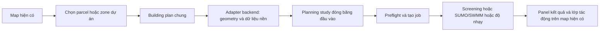

# Nối simulation với map của main

**Cập nhật sau đánh giá:** branch simulation đã bổ sung gộp parcel từ snapshot và catalog QCVN. Những mục "chưa có" dưới đây mô tả thời điểm đối chiếu main `93a44c6`/simulation `4c764fe`; xem [contract mới dùng ngay](simulation-submission-handoff.md) để nối grouped mode. Adapter live toàn thành phố/zoning revision và React main vẫn chưa được triển khai trong nâng cấp này.

Ngày đọc: 14/10/2026. Đã fetch và đọc `origin/main` tại commit **93a44c6** bằng `git show`; không đổi branch, merge hoặc sửa frontend nhóm. Simulation được đối chiếu với branch `feat/khoi-building-impact-simulation`, commit **4c764fe**.

## 1. Main hiện có gì?

| Thành phần | Hành vi đã đọc từ code | Ý nghĩa khi nối simulation |
|---|---|---|
| `frontend/src/features/map/datasets/BackendDataScene.tsx` | Click layer parcel lấy `properties.parcel_id`, mở chi tiết một parcel | Có điểm bắt đầu để thêm parcel vào khu dự án; chưa có tập ID parcel chọn cho simulation |
| `frontend/src/features/map/parcels/ParcelDetails.tsx` và `parcelApi.ts` | Đọc `/api/v1/parcels/{id}`: thuộc tính, diện tích, quy hoạch, giá tham chiếu | Dùng để kiểm tra nguồn/nhãn; contract chi tiết không khai báo geometry đầy đủ cho simulation |
| `frontend/src/features/zoning/useZoning.ts` | Lưu plan/scenario, tập `selected` và sketch | `selected` là ID **zone quy hoạch**, không phải ID parcel |
| `frontend/src/features/zoning/ZoningScene.tsx` | Shift-click chọn nhiều zone; lớp parcel hỗ trợ xem ranh và snapping | Không thể coi thao tác chọn zone là chọn nhiều thửa đất |
| `frontend/src/features/zoning/ZoningToolbar.tsx` | Gọi command `merge` với `zone_ids` | Có thể tái sử dụng trải nghiệm gộp vùng ở frontend |
| `backend/app/services/zoning/engine.py` | Merge zone cùng type, có chung cạnh và union thành Polygon hợp lệ; tạo zone ID mới | Đây là gộp vùng đề xuất, không hợp thửa pháp lý; zone mới chưa lưu quan hệ nhiều parcel nguồn |
| `frontend/src/features/zoning/types.ts` | Zone có geometry/type/area; type có FAR, coverage, max height/floors | Geometry có thể làm ranh dự án; các chỉ số type là giới hạn, không phải plan công trình thực tế |
| `backend/app/services/zoning/indicators.py` | Tính diện tích và giới hạn sàn/footprint từ FAR/coverage | Chưa phải dự báo cư dân, điện, nước, giao thông, SWMM |
| `backend/app/main.py` | Có zoning, parcels, integrated scenarios; chưa đăng ký các planning routers của branch simulation | Chưa có kết nối trực tiếp tới luồng planning/jobs mới trên main |

Main có `/simulation/integrated` và `/api/v1/scenarios/integrated/predict`; đó là luồng integrated trước đây, chưa phải workspace planning với so ứng viên, cộng dồn, jobs và sensitivity mới. Không thấy React frontend gọi planning API hoặc integrated prediction trong các file TS/TSX đã tìm.

## 2. Luồng nên nối

Frontend nhóm giữ quyền xử lý map và panel. Phần simulation cung cấp adapter, model, jobs và kết quả GeoJSON; không cần map nền thứ hai hoặc bắt người dùng copy JSON.

### Chọn trực tiếp parcel

1. Thêm một tập ID parcel dành cho khu dự án, độc lập với `zoning.selected` và parcel đang được mở chi tiết.
2. Khi người dùng chọn nhiều thửa liền kề cho **một công trình**, backend lấy geometry canonical đầy đủ từ warehouse, union và kiểm tra hợp lệ. Không lấy geometry từ MVT để tính: tile hiện đang simplify/clip; tile zoning còn clip theo vùng nghiên cứu.
3. Một nhóm parcel tạo **một Project**, một baseline tổng hợp và một development chung. Tổng số căn/cư dân/sàn được nhập cho nhóm một lần, không nhân với số parcel.
4. Giữ danh sách parcel ID và nhãn nguồn để audit, kiểm tra xung đột quy hoạch và tránh đếm lại tải.

### Bắt đầu từ workspace zoning

Người dùng chọn một zone đã vẽ/gộp và bấm mô phỏng. Dùng `plan_id`, revision, `scenario_id`, zone ID và geometry để xác định khu dự án. Backend tra các parcel giao với zone, ghi diện tích giao và phần nằm ngoài dữ liệu parcel. Không mặc định zone bằng đúng union parcel hoặc mọi parcel giao đều được dùng trọn.

FAR/coverage/max_floors là ràng buộc đề xuất. Phải có building plan riêng (footprint, công năng, tầng/sàn, cư dân hoặc chương trình sử dụng). Không coi max FAR là số sàn chắc chắn sẽ xây, hoặc suy occupancy thực từ nhãn quy hoạch.

## 3. Phần dùng lại được và phần còn thiếu

| Việc | Hiện trạng |
|---|---|
| Chạy model, so vị trí, cộng dồn và giai đoạn | Có trên branch simulation |
| Preflight, lưu study/job/run, polling, hủy/chạy tiếp | Có trên branch simulation |
| Capacity có nguồn/unknown hoặc gói giả lập có nhãn, sensitivity | Có trên branch simulation |
| GeoJSON kết quả cho lớp parcel, trường, bóng, đường, drainage | Có; frontend cần render lên map hiện có |
| Prepare từ snapshot đóng băng của team | Có nhưng là `/demo/system/prepare`, chỉ bật demo và chỉ geometry/parcel đã cài |
| Prepare từ parcel/zone hiện đang chọn trên main | Chưa có adapter live dành cho luồng này |
| Một building trên nhóm parcel | Chưa có schema/registry cho nhóm và baseline tổng hợp |
| Liên kết zoning revision/scenario với simulation run | Chưa có bridge |
| React panel nhập plan, theo dõi job và xem kết quả | Chưa nối vào main |

**Điểm không thể nối bằng cách chỉ đổi payload:** `system_parcel_bindings` hiện là project → một parcel ID; `attach_context()` kiểm tra geometry project bằng đúng geometry một parcel; `prepare()` tạo project riêng cho mỗi parcel. Geometry union sẽ bị từ chối hoặc mang sai ý nghĩa. Cần mở rộng adapter/registry theo nhóm, không giả ID của một parcel để chạy union.

## 4. Contract đề xuất cho frontend/backend

Đây là contract **đề xuất, chưa phải endpoint hiện có**:

- Một adapter chuẩn bị study, ví dụ `POST /api/v1/planning/prepare`, nhận nguồn lựa chọn (parcel group hoặc zoning reference), các nhóm ID và building plan theo project; nhận chế độ nền thật/giả lập có nhãn.
- Backend tra geometry và dữ liệu nền theo ID, đóng băng nguồn, thời gian, hash, revision; trả PlanningStudy hợp lệ và báo cáo phần thiếu/xung đột. Không phụ thuộc các layer đang bật/tắt trên màn hình.
- Zoning reference gồm `plan_id`, revision, `scenario_id`, `zone_ids`; backend kiểm tra revision để không dùng plan đã thay đổi.
- Mỗi project lưu `parcel_ids[]`; các nhóm cùng hoạt động không được chồng đất. Khi so các phương án thay thế có chung đất, registry phải nhận diện cùng nền vật lý để không đếm hai lần.
- Sau khi có study, dùng planning APIs hiện có: preflight → lưu study → tạo run → poll job → đọc run/artifacts. Dữ liệu background snapshot khác với zoning baseline; không dùng nhãn `reference`/`locked` để mặc định baseline đã được kiểm chứng.
- Kết quả giữ before/after/delta, đơn vị, comparability, nguồn và unavailable reasons; dữ liệu hiện trạng thật thiếu vẫn unknown. Lớp quy hoạch nguồn của map chỉ là context, không tự thành capacity hay kết quả flood calibration.

## 5. Thứ tự triển khai phù hợp với phân công nhóm

1. **Simulation/backend:** adapter nhóm parcel và zoning reference; geometry canonical/union; baseline và ledger nhóm; contract và fixture request/response để bàn giao.
2. **Simulation/backend:** kiểm thử một building trên hai thửa chung cạnh, nhóm không liền kề, footprint vượt ranh, ID/revision sai, baseline thiếu và đếm tải đúng một lần; kiểm thử cùng chương trình trên nhóm A/B.
3. **Frontend nhóm:** chọn parcel/zone → panel building plan → preflight/job → result panel; bind GeoJSON vào map hiện tại. Tránh xung đột click giữa zoning editor, inspect parcel và simulation selection.
4. **Tích hợp:** chạy một case thật xuyên React → backend → worker → map kết quả. Không coi merge branch hoặc demo standalone đã chạy là chứng cứ luồng này đã hoàn thành.

## Kết luận

Có nền tảng để nối simulation thành một tính năng của map hiện có. Main đã có geometry và editor hữu ích, nhưng chưa có bridge tới planning engine mới. Luồng một building trên nhiều parcel làm được bằng một lớp adapter và registry nhóm; không cần xây lại map, cũng không thể dùng nguyên prepare demo hiện tại mà không sửa.
